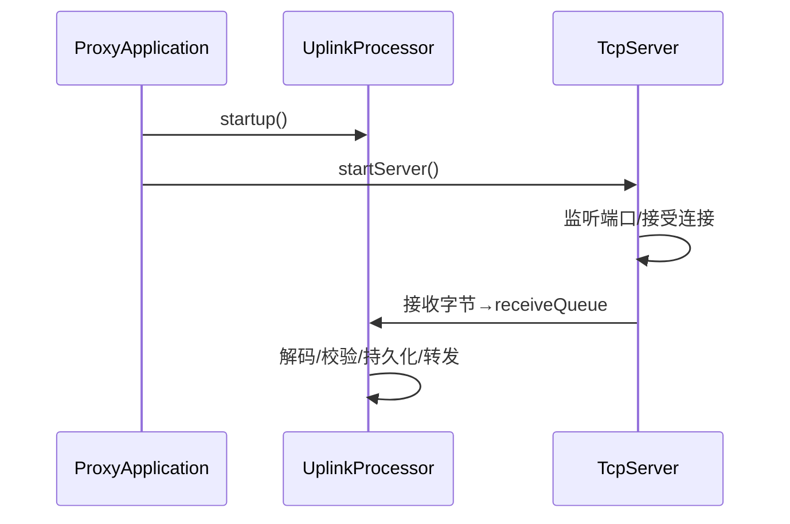

# ProxyTcp 详细设计（TCP 接入网关）

- 版本：v0.1
- 状态：草稿
- 最后更新：2026-10-16
- 作者：架构师 Agent（基于 `2_codes/ProxyTcp` 代码）

> 组件边界与数据流见 `../architecture.md` 与 `../../system-overview.md`；
> 报文协议见 `../message-protocol.md`；数据模型见 `../data-model.md`。

## 1. 设计目标与约束

- 稳定接入海量设备 TCP 长连接；上行可靠解析/持久化/转发；下行可靠投递/重发。
- 依赖：Spring Boot 2.1.6、Protobuf、RabbitMQ、H2/MongoDB、BouncyCastle（加密）、Jersey（REST）。
- 存储可切换（H2 开发 / MongoDB 生产，`Constants.DB_TYPE`）。

## 2. 包结构与职责

| 包 | 职责 |
| --- | --- |
| `com.proxy` | 启动类、常量、Controller、定时任务、Bean 工具 |
| `codec` | 报文编解码（`Message`、`TransportCoder`、`v2` 实现） |
| `transport` | 上行/下行处理、`amq`（RabbitMQ 收发）、重发 |
| `tcp.server` | TCP 服务端（`TcpServer`、`ServerThread`）、连接缓存 |
| `persistence` | 设备/上行/下行/失败消息的 Service 与 H2/Mongo 实现 |
| `concurrent` | 线程池（`ThreadPoolExecutors`、MDC 包装） |
| `model` | 领域模型（TransportMessage、DeviceInfo、各类消息） |
| `utils` | 字节/哈希/MD5/ID 生成（雪花）、TTL 等 |

## 3. 启动流程

`ProxyApplication.main`：
1. 启动 Spring 上下文，注册两个阻塞队列：`receiveQueue`（上行）、`sendQueue`（下行，容量 50）。
2. `TransportUplinkProcessor.startup()` 启动上行处理。
3. `TcpServer.startServer()` 启动 TCP 监听。

## 4. 上行处理（UplinkProcessor）

`transport/TransportUplinkProcessor`：
1. 从 `receiveQueue` 取消息。
2. 解码（`codec`）：TransportData 41 字节 + ServiceData。
3. 签名/校验、去重（窗口 `duplicateMessageDurationMinutes`）。
4. 持久化：`UplinkMessageService`、`DeviceInfoService`（更新 IP/端口/状态）。
5. 经 RabbitMQ 发布上行（`transport/amq/ProxyMQProducer`）。

## 5. 下行处理（DownlinkProcessor + Resend）

- `transport/TransportDownlinkProcessor.process()`：接收 `DownlinkTransportMessage`，编码后经设备会话（`tcp` 连接缓存）投递。
- `transport/ResendDownlinkProcessor.resend()`：离线/失败重发。
- 状态机：`SENT → ACKNOWLEDGED / FAILED → RESEND_OVERTIMES`（见 `data-model.md` §4）。
- 锁：`Constants.LOCK_TYPE_*` 防止并发冲突（uplink/downlink/resend/send_failure/delete）。

## 6. 持久化抽象

- 接口：`DeviceInfoService`、`UplinkMessageService`、`DownlinkMessageService`、`SendFailureMessageService`、`ProxyLockServiceMongo`。
- 实现：H2（`persistence/h2`）与 MongoDB（`persistence/mongodb`），由 `DB_TYPE` 切换。

## 7. 定时任务

| 类 | 职责 |
| --- | --- |
| `ScheduledTask` | 综合调度 |
| `ScheduledDownlinkSender` | 周期性下发待发下行 |
| `ScheduledDeleteObsoleteFailedMessageTask` | 清理过期失败消息（`deleteObsoleteFailedMessage` 锁） |

## 8. 并发与可靠性

- `concurrent`：自定义线程工厂、MDC 透传线程池，保障日志链路。
- 队列限流：`sendQueue` 容量 50，防下游背压。
- 可靠性：持久化 + 重发 + 去重 + 锁，详见 `../message-protocol.md` §9 待协调项。

## 9. 安全设计

- 接入：设备鉴权（标识类型 §6）、连接管理。
- 传输：业务数据可加密（`serviceDataEncryption=1` aes-gcm，BouncyCastle）。
- 完整性：16 字节 `MessageSignature`（算法待固化，见协议 OI-002）。
