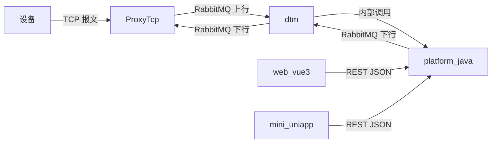

# 接口设计（API Design）

- 版本：v0.1
- 状态：草稿
- 最后更新：2026-10-16
- 作者：架构师 Agent

> 集中定义组件间与对外接口契约。组件设计引用本文件。事实来源：`ProxyTcp/ProxyController`、
> `web_vue3` 脚手架 `src/types/index.ts`（`ApiResponse`）。

## 1. 接口全景



## 2. 设备 ↔ 网关（TCP 报文）

- 协议：`message-protocol.md`（帧结构、编码、加密、服务类型）。
- 方向：上行（设备→网关）、下行（网关→设备）。
- 可靠性：签名校验、去重、持久化、重发（见 `data-model.md`）。

## 3. 网关 ↔ dtm（RabbitMQ）

- 传输介质：RabbitMQ（配置见 `Constants.RABBITMQ_*`）。
- 上行：网关发布上行报文 → dtm 消费 → `platform_java`。
- 下行：`platform_java` 经 dtm 发布下行 → 网关消费 → 设备。
- 可靠性：至少一次投递、失败重试、死信（详见 `dtm` 设计与 `13_test/`）。

## 4. 网关管理 REST（现状，来自 `ProxyController`）

| 方法 | 路径 | 请求体 | 响应 |
| --- | --- | --- | --- |
| GET | `/ping/{pong}` | — | 原样返回 `pong`（探活） |
| POST | `/downlink` | `ServiceRequest`(JSON) | `ServiceResponse`(JSON) |
| POST | `/resendDownlink` | `ResendMessage`(JSON) | `ServiceResponse`(JSON) |
| GET | `/DownlinkMessages` | — | `List<DownlinkMessage>` |
| GET | `/UplinkMessages` | — | `List<UplinkMessage>` |
| GET | `/DeviceInfos` | — | `List<DeviceInfo>` |
| GET | `/DeviceInfos/{deviceId}` | — | `DeviceInfo` |

### ServiceRequest / ServiceResponse（关键字段）

- `ServiceRequest`：`eventId, deviceId, nodeId, serviceType, serviceVersion, serviceData, serviceDataEncoding, serviceDataProtocolVersion, serviceEncryption`。
- `ServiceResponse`：`status(200/300/400), message`。

## 5. 后台对外 REST（platform_java，规范建议）

供 `web_vue3` 与 `mini_uniapp` 调用，统一约定：

### 5.1 统一响应体（对齐 web_vue3 `ApiResponse`）

```json
{
  "code": 200,
  "message": "success",
  "data": { }
}
```

### 5.2 鉴权

- 登录获取 Token（Bearer），后续请求头 `Authorization: Bearer <token>`。
- 运营用户（web）与终端用户（mini）权限隔离。

### 5.3 主要资源（建议）

| 资源 | 说明 |
| --- | --- |
| `/api/auth/*` | 登录、刷新令牌 |
| `/api/devices` | 设备列表、详情、增删改 |
| `/api/devices/{id}/downlink` | 下发下行指令 |
| `/api/devices/{id}/status` | 设备实时状态 |
| `/api/data` | 设备数据查询/统计 |
| `/api/alarms` | 告警查询/处理 |
| `/api/users` `/api/roles` | 用户与角色（运营） |

> 路径风格、版本化（`/api/v1`）、分页、错误码在平台落地时固化并同步各端。

## 6. 前端 ↔ 后台（REST JSON）

- `web_vue3`：Axios 封装拦截器与统一错误处理，响应结构见 `ApiResponse`（`web_vue3/README.md`）。
- `mini_uniapp`：`uni.request` 封装（`src/api/request.ts`）。

## 7. 待协调项

- 网关管理 REST 路径风格（驼峰 `/DeviceInfos` vs 连字符 `/device-infos`）需在基线统一。
- 后台对外 API 的版本化与鉴权方案需在 `platform_java` 落地时固化。
