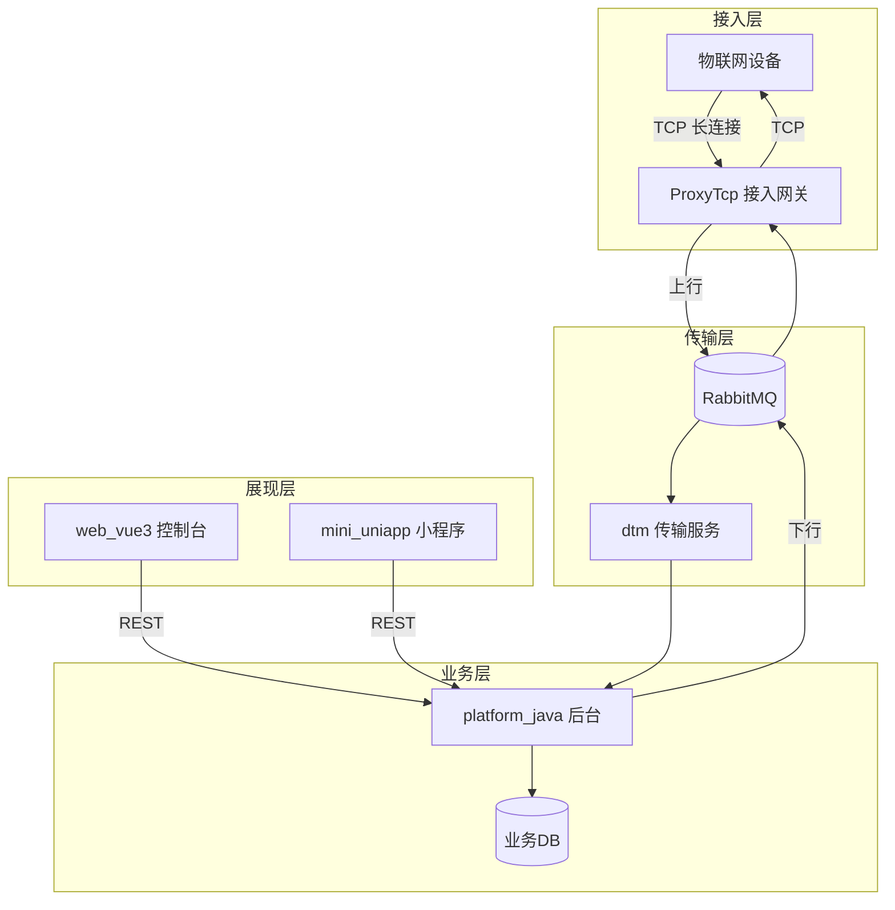

# 总体技术架构（Architecture）

- 版本：v0.1
- 状态：草稿
- 最后更新：2026-10-16
- 作者：架构师 Agent

> 本文件为架构集中定义，组件设计见各 `*/design.md`，并引用本文件，不重复定义。

## 1. 分层架构

## 2. 分层职责

| 层 | 组件 | 职责 | 关键选型 |
| --- | --- | --- | --- |
| 接入层 | ProxyTcp | 设备 TCP 接入、编解码、会话、下行投递、持久化 | Spring Boot、原生 TCP、Protobuf、RabbitMQ、H2/MongoDB |
| 传输层 | dtm + RabbitMQ | 上下行消息可靠转发、削峰、解耦 | 消息队列、至少一次投递 |
| 业务层 | platform_java | 设备管理、业务处理、规则、对外 API | Java、REST、关系/文档 DB |
| 展现层 | web_vue3 / mini_uniapp | 运营 / 终端用户交互 | Vue3、uni-app |

## 3. 关键设计决策

- **接入与业务解耦**：`ProxyTcp` 只做接入与转发，业务在 `platform_java`，通过 `dtm`+MQ 解耦，任一节点故障不致命。
- **存储双实现**：`ProxyTcp` 支持 H2（轻量/嵌入式，开发测试）与 MongoDB（生产）切换（`Constants.DB_TYPE`）。
- **报文版本化**：传输版本 V1/V2、业务数据编码 byte/protobuf/json，便于演进（见 `message-protocol.md`）。
- **可靠下行**：下行指令持久化、离线缓存、重发上限（`Constants.Status` / `RESEND_OVERTIMES`）。
- **统一前端响应**：后台 API 统一 `ApiResponse`（见 `api-design.md` 与 `web_vue3` 脚手架 `src/types`）。

## 4. 非功能架构

- **扩展性**：接入层（网关）、业务层可水平扩展；MQ 提供天然削峰。
- **可靠性**：报文持久化 + 重发 + 幂等（去重窗口 `duplicateMessageDurationMinutes`）。
- **可观测**：日志（log4j）、指标、链路（见 `../15_maintain/monitoring.md`）。

## 5. 关联文档

- 数据流与组件边界：`../system-overview.md`
- 报文协议：`message-protocol.md`
- 数据模型：`data-model.md`
- 接口契约：`api-design.md`
