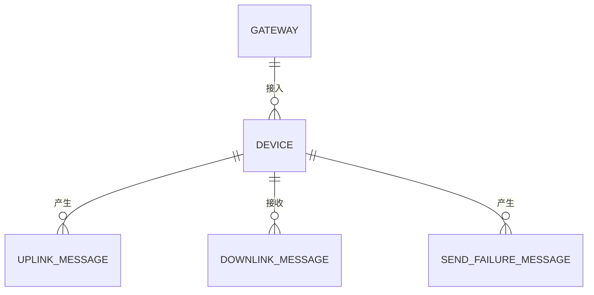
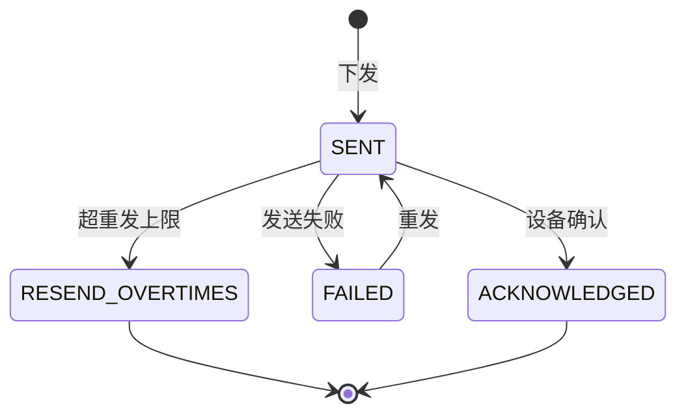

# 核心数据模型（Data Model）

- 版本：v0.1
- 状态：草稿
- 最后更新：2026-10-16
- 作者：架构师 Agent

> 集中定义平台核心实体。组件设计引用本文件，不重复定义。事实来源：`ProxyTcp`
> 持久化模型（`persistence/model/*`）与总体架构。

## 1. 实体关系

## 2. 设备（Device / DeviceInfo）

来源：`ProxyTcp/persistence/model/DeviceInfo.java`。

| 字段 | 类型 | 说明 |
| --- | --- | --- |
| deviceId | String | 设备标识（VIN/终端号/设备ID，见协议 §6） |
| ip | String | 设备当前 TCP 连接 IP |
| port | int | 设备连接端口 |
| 状态 | enum | 在线 / 离线 |
| 其他元数据 | — | 注册时间、最后心跳时间等 |

> `platform_java` 侧设备模型在其设计文档细化（含鉴权、绑定用户等）。

## 3. 上行消息（UplinkMessage）

来源：`ProxyTcp/persistence/model/UplinkMessage.java`。

| 字段 | 说明 |
| --- | --- |
| messageId / eventId | 消息与业务标识 |
| deviceId / nodeId | 设备与节点 |
| serviceType / serviceVersion | 服务类型与版本 |
| serviceData | 业务数据（按编码/加密） |
| messageCreationTime | 事件时间 |
| 状态 | 持久化状态 |

## 4. 下行消息（DownlinkMessage）

来源：`ProxyTcp/persistence/model/DownlinkMessage.java`，状态机见 `Constants.Status`：

| 状态 | 常量 | 含义 |
| --- | --- | --- |
| SENT | `Status.SENT` | 已下发 |
| ACKNOWLEDGED | `Status.ACKNOWLEDGED` | 已确认 |
| FAILED | `Status.FAILED` | 失败 |
| RESEND_OVERTIMES | `Status.RESEND_OVERTIMES` | 超重发上限 |
| UNKNOW | `Status.UNKNOW` | 未知 |

## 5. 发送失败消息（SendFailureMessage）

来源：`ProxyTcp/persistence/model/SendFailureMessage.java`。错误码见 `Constants`：

| 错误码 | 常量 | 含义 |
| --- | --- | --- |
| 1 | `SEND_FAILURE_ERROR_CODE_OFFLINE` | 设备离线 |
| 2 | `SEND_FAILURE_ERROR_CODE_MULTIPLE_SEND_FAILURE` | 多次发送失败 |
| 3 | `SEND_FAILURE_ERROR_CODE_UNKNOW_VEHICLE` | 未知设备 |
| 4 | `SEND_FAILURE_ERROR_CODE_ENCODE_ERROR` | 编码错误 |
| 5 | `SEND_FAILURE_ERROR_CODE_OTHER` | 其他 |

## 6. 网关（GatewayProfile）

来源：`ProxyTcp/model/GatewayProfile.java`，描述网关自身配置（连接参数、MQ 配置等）。

## 7. 存储映射

| 实体 | H2（`persistence/h2/model`） | MongoDB（`persistence/mongodb`） |
| --- | --- | --- |
| DeviceInfo | `h2/model/DeviceInfo` | `mongodb` + Repository |
| UplinkMessage | `h2/model/UplinkMessage` | `mongodb` |
| DownlinkMessage | `h2/model/DownlinkMessage` | `mongodb` |
| SendFailureMessage | `h2/model/SendFailureMessage` | `mongodb` |

通过 `DeviceInfoService` / `DownlinkMessageService` 等接口抽象，H2 与 Mongo 实现可切换（`Constants.DB_TYPE = h2 | mongo`）。
