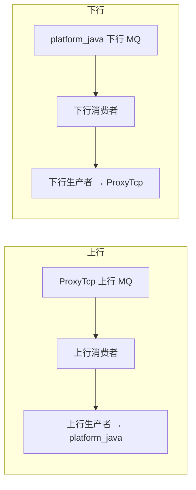
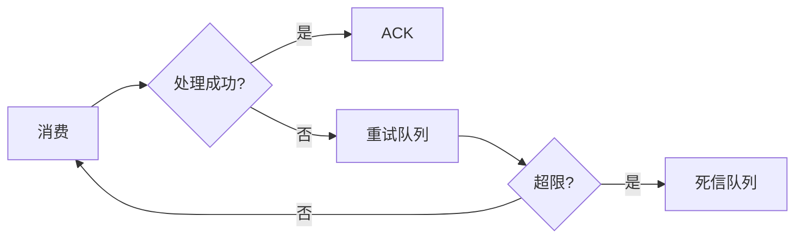

# dtm 详细设计（数据传输服务）

- 版本：v0.1
- 状态：草稿
- 最后更新：2026-10-16
- 作者：架构师 Agent

> 组件边界见 `../architecture.md`；MQ 契约见 `../api-design.md` §3。

## 1. 设计目标与约束

- 位于 `ProxyTcp` 与 `platform_java` 之间，负责上下行消息可靠转发、缓冲削峰、解耦。
- 不处理业务，只保障传输可靠性。

## 2. 模块划分

| 模块 | 职责 |
| --- | --- |
| 上行消费者 | 消费网关上行，转发至后台 |
| 上行生产者 | 向后台队列发布 |
| 下行消费者 | 消费后台下行，转发至网关 |
| 下行生产者 | 向网关队列发布 |
| 可靠性 | 重试、死信、积压监控 |

## 3. 可靠性设计

- **至少一次投递**：消费者处理成功才 ack；失败进重试/死信队列。
- **削峰**：队列缓冲 + 批处理，保护后端。
- **幂等**：上游去重（`ProxyTcp` 已做），本层保障不重复处理导致的副作用。
- **可观测**：积压、吞吐、时延指标（见 `../../15_maintain/monitoring.md`）。

## 4. 消息格式

- 上行：复用 `../message-protocol.md` Transport 报文（JSON/Protobuf 封装于 MQ 消息体）。
- 下行：`DownlinkTransportMessage` 等价结构。

## 5. 故障处理

## 6. 技术选型（建议）

- 与 RabbitMQ 直接交互（Spring AMQP / 原生客户端）；可水平扩展多实例。
