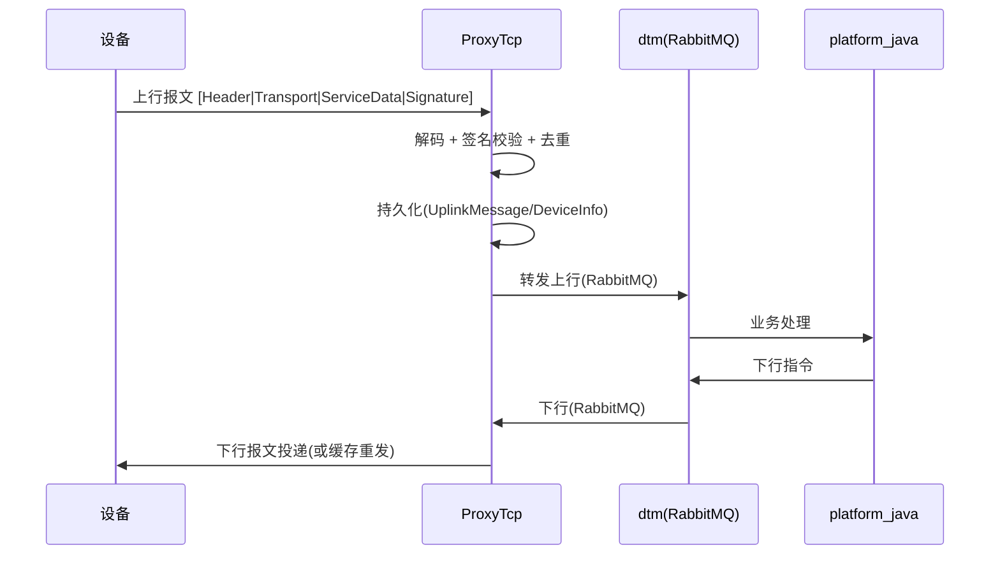

# 报文协议（Message Protocol）

- 版本：v0.1
- 状态：草稿（含待协调项）
- 最后更新：2026-10-16
- 作者：架构师 Agent
- 事实来源：`2_codes/ProxyTcp/报文结构.pptx` + `ProxyTcp` 代码（`codec/*`、`model/MessageHeader`、`model/CommonTransportMessage`、`Constants`）

> ⚠️ 本协议存在 **pptx 设计稿** 与 **代码实现** 两处口径差异，列于文末"待协调项"。
> 代码实现（`codec/Message.toByteArray`）为当前运行事实，落地以代码为准，设计稿供回溯。

---

## 1. 报文总体结构

设备与 `ProxyTcp` 之间的 TCP 报文，逻辑上由四段组成（与代码 `codec.Message` 一致）：

`codec.Message.toByteArray()` = `messageHeader + transportData + serviceData + messageSignature`，
其中 `Constants.SIGNATURE_LENGTH = 16`。

---

## 2. MessageHeader（4 字节，代码事实）

来自 `model/MessageHeader`：

| 偏移 | 字段 | 长度 | 含义 |
| --- | --- | --- | --- |
| 0 | `TransportDataEncoding` | 1 B | 传输数据编码（见 §5） |
| 1 | `TransportVersion` | 1 B | 传输版本（V1=1 / V2=2） |
| 2–3 | `TransportDataLength` | 2 B | 后续 TransportData 长度（大端） |

> 注：`MessageHeader.MESSAGE_HEADER_LENGTH=4`、`TRANSPORT_LENGTH_SIZE=2`、
> `TRANSPORT_CRC_SIZE=1`（CRC 字段在代码中未纳入 `toByteArray`，见待协调项）。

---

## 3. TransportData 固定段（41 字节，V2 实现）

来自 `codec/v2/TransportcoderByteImplV2` 与 `model/CommonTransportMessage.TRANSPORT_PART_FIX_LENGTH = 41`：

| 偏移 | 字段 | 长度 | 类型 | 含义 / 编码 |
| --- | --- | --- | --- | --- |
| 0–10 | `deviceId` | 11 B | String(ASCII) | 设备标识（VIN / 终端号 / 设备ID，右补空格） |
| 11–21 | `nodeId` | 11 B | String(ASCII) | 节点标识 |
| 22–27 | `messageCreationTime` | 6 B | BCD | 事件时间：`[年-100][月][日][时][分][秒]` |
| 28–31 | `messageId` | 4 B | int(大端) | 事件 Id（网关生成，雪花算法） |
| 32 | `serviceType` | 1 B | byte | 服务类型（见 §4） |
| 33 | `serviceVersion` | 1 B | byte | 服务版本号 |
| 34 | `serviceDataEncoding` | 1 B | byte | 业务数据编码：0=byte, 1=protobuf, 2=json |
| 35 | `serviceDataProtocolVersion` | 1 B | byte | 业务数据协议版本（从 1 起） |
| 36 | `serviceDataEncryption` | 1 B | byte | 业务数据加密：0=无, 1=aes-gcm |
| 37–40 | `eventId` | 4 B | int(大端) | 业务 Id |

校验：11+11+6+4+1+1+1+1+1+4 = **41 字节** ✓

---

## 4. 服务类型（serviceType）

来自 `Constants`：

| 值 | 常量 | 含义 | 方向 |
| --- | --- | --- | --- |
| 0 | `SERVICETYPE_ACK` | 应答/确认 | 双向 |
| 1 | `SERVICETYPE_HEART_BEAT` | 心跳 | 设备 → 平台 |
| 2 | `SERVICETYPE_ONLINE_CHECK` | 在线检测 | 双向 |

---

## 5. 编码与加密

- **传输编码 `TransportDataEncoding`**：0=byte, 1=protobuf, 2=json（见 `Constants.ENCODINGTYPE_*`）。
- **业务数据编码 `serviceDataEncoding`**：0=byte, 1=protobuf, 2=json。
- **业务数据加密 `serviceDataEncryption`**：0=无, 1=aes-gcm。

---

## 6. 设备标识类型（deviceId 解析）

来自 `Constants`（`VEHICLEIDENTIFIERTYPE_*`），`deviceId` 的语义由上下文/配置决定：

| 值 | 常量 | 含义 |
| --- | --- | --- |
| 0 | `VEHICLEIDENTIFIERTYPE_VIN` | VIN（车辆识别码） |
| 1 | `VEHICLEIDENTIFIERTYPE_TERMINALNO` | 终端号 |
| 2 | `VEHICLEIDENTIFIERTYPE_DEVICEID` | 设备 ID |

---

## 7. 设备/TBOX 业务报文帧（pptx 设计稿，供回溯）

`报文结构.pptx` 第 1 页给出设备侧（TBOX）业务报文帧，与 §2/§3 代码实现字段相近但帧头不同：

| 字段 | 长度 | 含义 |
| --- | --- | --- |
| `header` | 2 B | 固定 `0xFF 0xEE`（报文标识） |
| `length` | 2 B | 报文长度（除去 `0xFF 0xEE` 与 `crc`） |
| `messageId` | 4 B | 消息编号（设备生成） |
| `messageTime` | 6 B | 消息生成时间 |
| `serviceType` | 1 B | 服务类型 |
| `serviceVersion` | 1 B | 服务版本 |
| `serviceData` | 变长 | 业务数据 |
| `cryptFlag` | 1 B | 是否加密 |
| `crc` | 1 B | 校验（对报文头及各字节按位…） |

---

## 8. 上行 / 下行流程

---

## 9. 待协调项（Open Issues，需在设计基线前确认）

| 编号 | 差异 | pptx 设计稿 | 代码实现 | 建议 |
| --- | --- | --- | --- | --- |
| OI-001 | 帧头魔数 | `0xFF 0xEE` 2 字节 | 4 字节头 `[Encoding][Version][Length]`，无魔数 | 明确是否保留魔数用于分包/粘包识别 |
| OI-002 | 校验/签名 | `crc` 1 字节 | `MessageSignature` 16 字节 | 确认 16 字节为签名还是校验和，补齐算法说明 |
| OI-003 | 时间字段位置 | `messageTime` 在 `serviceData` 前 | 归入 TransportData 偏移 22 | 统一为 TransportData 内 |
| OI-004 | `length` 语义 | 含/不含 crc | `TransportDataLength` 仅指 TransportData | 明确长度字段覆盖范围 |

> 落地建议：以代码实现为权威，修订 pptx 或在本文件固化，避免双口径。
