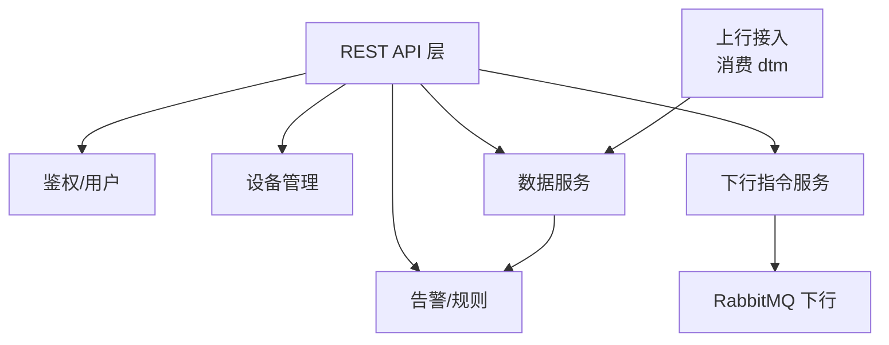
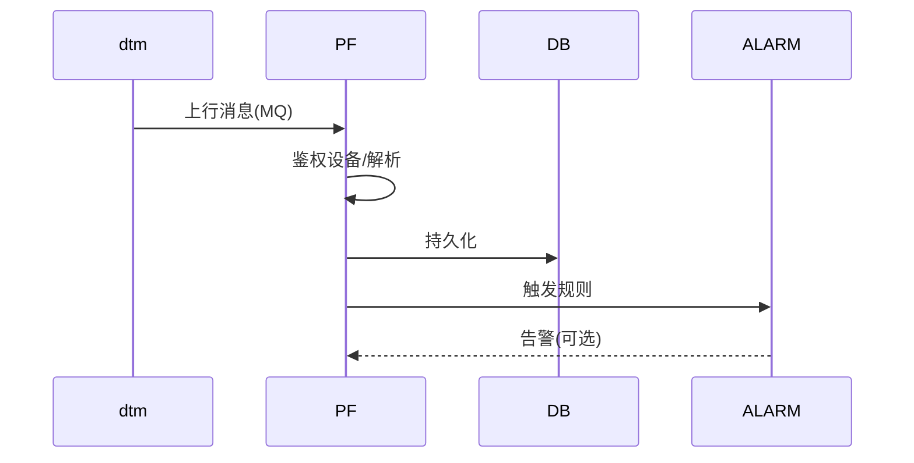
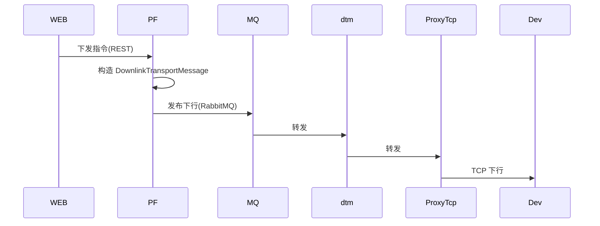

# platform_java 详细设计（后台业务平台）

- 版本：v0.1
- 状态：草稿
- 最后更新：2026-10-16
- 作者：架构师 Agent

> 组件边界见 `../architecture.md`；接口契约见 `../api-design.md`；数据模型见 `../data-model.md`。

## 1. 设计目标与约束

- 设备管理、业务处理、规则/告警、对外 REST API。
- 消费 `dtm` 上行数据；经 `dtm` 下发下行指令。
- 服务 `web_vue3` 与 `mini_uniapp`（统一 `ApiResponse`、Token 鉴权）。

## 2. 模块划分

| 模块 | 职责 |
| --- | --- |
| 鉴权/用户 | 登录、Token、角色权限（运营/终端） |
| 设备管理 | 注册、鉴权、状态、元数据 CRUD |
| 数据服务 | 上行数据接入、持久化、检索、统计 |
| 告警/规则 | 阈值规则、告警生成与推送 |
| 下行指令 | 生成下行 → RabbitMQ → dtm → ProxyTcp → 设备 |

## 3. 关键流程

### 3.1 上行数据接入

### 3.2 下行指令下发

## 4. 数据模型扩展

在 `data-model.md` 基础上，后台侧增加：用户/角色、设备绑定关系、告警记录、规则配置。
具体字段在代码落地时固化。

## 5. 接口设计

- 对外 REST 见 `../api-design.md` §5（统一 `ApiResponse`、Token 鉴权、资源规划）。
- 与 `dtm` 的 MQ 契约见 `../api-design.md` §3。

## 6. 安全设计

- 接口鉴权（Token）、数据权限隔离（运营 vs 终端）。
- 设备接入鉴权信息由本平台维护，与 `ProxyTcp` 共享设备标识口径（`message-protocol.md` §6）。

## 7. 技术选型（建议）

- Spring Boot（与 `ProxyTcp` 技术栈一致）、关系/文档数据库、Redis（缓存/会话）、
  RabbitMQ 客户端。具体在落地时确定。
