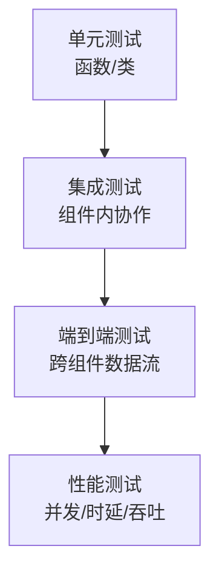

# 测试策略（Test Strategy）

- 版本：v0.1
- 状态：草稿
- 最后更新：2026-10-16
- 作者：测试 Agent

## 1. 分层测试模型

| 层 | 目标 | 覆盖对象 | 建议工具 |
| --- | --- | --- | --- |
| 单元测试 | 函数/类正确性 | 编解码、工具、单服务方法 | JUnit5（Java）/ Vitest（前端） |
| 集成测试 | 组件内协作（DB、MQ） | 持久化、MQ 收发、Controller | Spring Test / Testcontainers |
| 端到端 | 跨组件数据流 | 设备→网关→dtm→后台→前端 | 设备模拟器 + 自动化脚本 |
| 性能测试 | 并发/时延/吞吐 | 网关接入、MQ 转发 | JMeter / 自研压测 |

## 2. 质量门禁

- 单元测试覆盖率 ≥ 60%（核心编解码/协议 ≥ 80%）。
- 集成测试全绿方可进入端到端。
- P0 业务需求（见 `../11_requirements/business-requirements.md`）必须有对应验收用例。

## 3. 环境与数据

- 测试环境独立（`dev/test`），数据可重置。
- 设备模拟器：模拟 TCP 设备发送上行、接收下行（见 `ProxyTcp/test-plan.md`）。

## 4. 测试资产

- 用例以表格管理（编号 / 前置 / 步骤 / 期望 / 优先级）。
- 测试报告模板：见各组件 `test-plan.md` 末节。

## 5. 关联文档

- 需求基线：`../11_requirements/`
- 设计契约：`../12_design/`
- 部署：`../14_deploy/`
