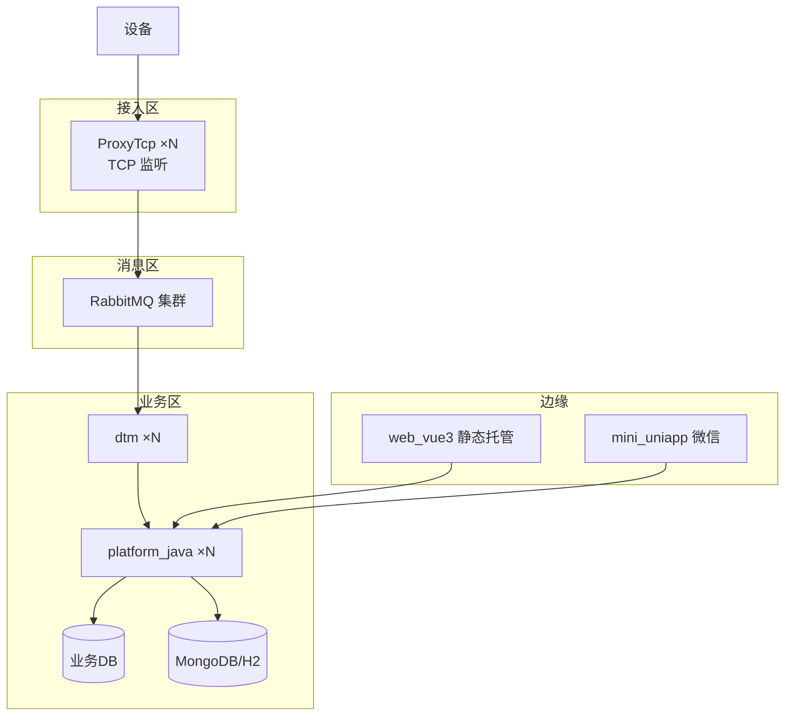

# 部署架构（Deploy Architecture）

- 版本：v0.1
- 状态：草稿
- 最后更新：2026-10-16
- 作者：DevOps Agent

## 1. 部署拓扑

## 2. 依赖中间件

| 中间件 | 用途 | 部署 |
| --- | --- | --- |
| RabbitMQ | 上下行消息 | 单机/集群，启用 management 插件 |
| MongoDB | 网关/后台持久化（生产） | 副本集 |
| 关系数据库 | 后台业务数据 | 主从 |
| Redis（建议） | 缓存/会话 | 哨兵 |

## 3. 环境

| 环境 | 用途 | 数据 |
| --- | --- | --- |
| dev | 开发自测 | 独立、可脏 |
| test | 集成/回归 | 接近生产 |
| prod | 生产 | 严格管控、备份 |

## 4. 部署形态

- **Java 服务**（ProxyTcp / platform_java / dtm）：jar + systemd / 容器。
- **前端**（web_vue3）：静态资源托管（Nginx / 对象存储 / CDN）。
- **小程序**（mini_uniapp）：微信平台审核发布。

## 5. 高可用

- 无状态服务（dtm/platform_java）多实例负载均衡。
- 有状态接入（ProxyTcp）按连接分片；MQ/DB 集群化。
- 详见各组件 `deploy.md` 与 `../15_maintain/`。

## 6. 关联文档

- 设计：`../12_design/architecture.md`
- 运维：`../15_maintain/monitoring.md`、`../15_maintain/ops-runbook.md`
