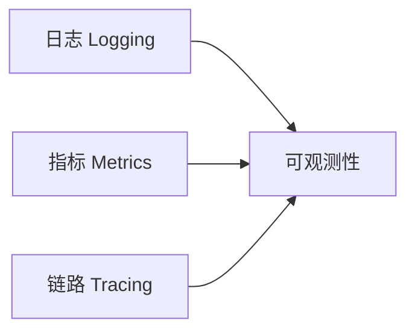

# 监控告警体系（Monitoring）

- 版本：v0.1
- 状态：草稿
- 最后更新：2026-10-16
- 作者：运维 Agent

## 1. 可观测三支柱

| 支柱 | 目标 | 建议 |
| --- | --- | --- |
| 日志 | 排查问题、审计 | 统一 log4j 格式、集中采集（ELK/Loki） |
| 指标 | 趋势、告警 | Prometheus + Grafana |
| 链路 | 跨组件追踪 | 接入/业务/传输链路 ID 透传 |

## 2. 关键指标

### 接入层（ProxyTcp）

- 在线设备连接数、新建/断开速率。
- 上行/下行消息速率、时延（P95）。
- 下行失败率、重发次数、死信数。
- JVM：GC、线程、堆内存。

### 传输层（dtm / RabbitMQ）

- 队列积压（backlog）、消费速率、重试/死信数。

### 业务层（platform_java）

- API QPS、错误率、时延。
- 设备数据落库延迟、规则触发数。

### 前端

- 页面加载、JS 错误率（前端监控）。

## 3. 告警规则（示例）

| 指标 | 阈值 | 级别 |
| --- | --- | --- |
| 下行失败率 | > 5% 持续 5min | P1 |
| MQ 积压 | > N 万条 | P1 |
| 设备掉线率 | 突增 > 20% | P1 |
| API 错误率 | > 1% | P2 |
| JVM 堆 | > 85% | P2 |

## 4. 日志规范

- 统一字段：时间、级别、组件、链路ID、设备ID（如有）。
- 敏感信息脱敏（设备密钥、Token）。
- 参见 `../doc-conventions.md`。

## 5. 关联文档

- 部署：`../14_deploy/deploy-architecture.md`
- 应急：`ops-runbook.md`
