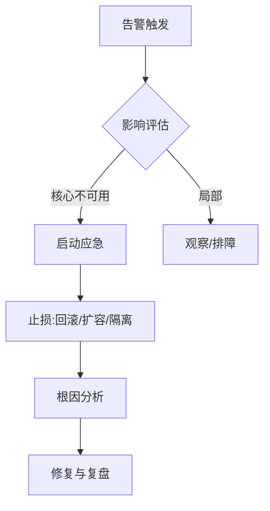

# 运维手册与应急预案（Ops Runbook）

- 版本：v0.1
- 状态：草稿
- 最后更新：2026-10-16
- 作者：运维 Agent

## 1. 日常运维

- **发布**：按 `../14_deploy/` 各组件手册灰度发布，先非核心后核心。
- **变更**：变更单 + 回滚预案；数据库变更向前兼容。
- **备份**：数据库定期备份；配置文件版本管理。
- **巡检**：每日检查指标面板与告警（见 `monitoring.md`）。

## 2. 通用应急流程

## 3. 常见故障与处置

| 故障 | 现象 | 处置 |
| --- | --- | --- |
| 网关连接激增掉线 | 在线数骤降 | 检查资源/网络；扩实例；排查设备重连风暴 |
| MQ 积压 | 数据延迟 | 扩容消费者；检查下游健康 |
| 下行失败率高 | 指令不送达 | 检查设备在线；查 `SendFailureMessage` 错误码 |
| 数据库慢 | API 变慢 | 查慢查询/索引；扩容 |
| 证书/域名过期 | 小程序/前端不可达 | 更新 HTTPS 证书、域名白名单 |

## 4. 回滚策略

- Java 服务：保留上一 jar，重启（见各 `deploy.md`）。
- 前端：切换 `dist/` 软链/重新发布。
- 数据库：迁移脚本可回退或兼容旧版。

## 5. 沟通与复盘

- 应急群同步进展；事后产出故障报告（时间线、根因、改进项）。

## 6. 关联文档

- 监控：`monitoring.md`
- 部署：`../14_deploy/`
