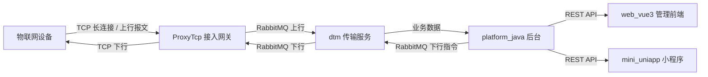

# 系统总体概述（System Overview）

本文件集中定义平台的**总体架构、组件职责边界与数据流**，是后续所有设计文档的
单一事实来源。各组件设计文档仅描述自身实现，并引用本文件，不重复定义架构。

---

## 1. 平台定位

**通用 IoT 物联网设备接入与管理平台**：为各类设备提供统一的 TCP 长连接接入、
上下行报文处理、设备管理与业务处理能力，并通过管理前端与移动小程序向运营人员
与终端用户开放。

核心能力：

- **设备接入**：海量设备 TCP 长连接接入与会话管理。
- **报文处理**：上行报文解析、校验、持久化与转发；下行指令编码与投递。
- **设备管理**：设备注册、鉴权、状态、元数据管理。
- **业务处理**：设备数据汇聚、规则处理、对外 API。
- **可视化**：Web 管理控制台 + 微信小程序移动端。

---

## 2. 组件职责边界（单一事实来源）

| 组件 | 类型 | 核心职责 | 不负责 |
| --- | --- | --- | --- |
| **ProxyTcp** | TCP 接入网关（Java/Spring Boot） | 设备 TCP 长连接接入、上下行报文编解码、会话缓存、RabbitMQ 上下行转发、H2/MongoDB 持久化 | 复杂业务处理、前端展示 |
| **dtm** | 数据传输服务 | 汇聚设备数据、在网关与后台间可靠转发、缓冲与削峰 | 设备直连接入、前端 |
| **platform_java** | 后台业务平台（Java） | 设备管理、业务处理、规则引擎、对外 REST API | 设备 TCP 直连、报文编解码细节 |
| **web_vue3** | 管理前端（Vue3） | 运营人员控制台：设备监控、配置、报表 | 设备接入、底层协议 |
| **mini_uniapp** | 移动小程序（uni-app） | 终端用户：设备状态查看、轻量交互 | 后台业务逻辑、设备接入 |

---

## 3. 总体数据流（Mermaid）

**方向约定**：

- **上行（Uplink）**：设备 → ProxyTcp → dtm → platform_java。
- **下行（Downlink）**：platform_java → dtm → ProxyTcp → 设备。
- **管理面**：platform_java 经 REST API 服务 web_vue3 与 mini_uniapp。

---

## 4. 技术栈概览

| 层 | 组件 | 关键技术 |
| --- | --- | --- |
| 接入层 | ProxyTcp | Spring Boot 2.x、Netty/原生 TCP、Protobuf、RabbitMQ、H2/MongoDB |
| 传输层 | dtm | 消息队列转发、缓冲削峰（具体实现见 `12_design/dtm/design.md`） |
| 业务层 | platform_java | Java 后台、REST API、设备管理、业务规则 |
| 前端 | web_vue3 | Vue3 + TypeScript + Pinia + Vue Router + Element Plus + Axios |
| 移动端 | mini_uniapp | uni-app（Vue3）+ TypeScript + Pinia + uni.request |

---

## 5. 非功能性目标（基线）

| 维度 | 目标（基线，后续细化为需求） |
| --- | --- |
| 接入规模 | 单网关支持万级并发设备长连接 |
| 可靠性 | 上下行报文不丢失（持久化 + 重发机制） |
| 时延 | 上行端到端 < 1s（P95） |
| 可用性 | 核心服务 ≥ 99.9% |
| 安全 | 设备接入鉴权、传输加密、接口鉴权 |

---

## 6. 演进路线

1. **第一阶段（当前）**：建立本技术体系文档（需求 → 设计 → 测试 → 部署 → 运维）。
2. **第二阶段**：基于设计文档落地/完善各组件代码（ProxyTcp 已有基础，补齐 platform_java / dtm，完善 web_vue3 / mini_uniapp）。
3. **第三阶段**：各组件独立建仓并提交至 `johnwei2006`，配套 CI/CD 与监控运维。

详见各生命周期目录。
